<!-- ============================================================
  GitHub Profile README
  Setup: create a repo named EXACTLY like your username
  (e.g. github.com/your-github-username/your-github-username),
  then put README.md and the assets/ folder in it.
  Search for "YOUR" and "EDIT" to find everything to replace.
============================================================= -->

<div align="center">



<br/>

<a href="https://www.linkedin.com/in/dykahatawa"></a>
<a href="mailto:dhatawaa@gmail.com"></a>
<a href="https://www.instagram.com/dhatawaa"></a>


</div>

<br/>

## About me

I'm a student from **Institut Teknologi Nasional Bandung** major, who enjoys turning ideas into working software.
I'm comfortable with **C++**, currently learning **Python**, and I like using AI tools to learn and build faster.
Outside the code editor, I stay active in student organizations and competitions.

```python
# about_me.py
me = {
    "name": "DYKA HATAWA",
    "major": "",            # EDIT
    "comfortable_with": ["C++"],
    "currently_learning": ["Python"],
    "database": "MySQL",
    "ai_tools": ["Gemini AI", "Claude"],
    "design": "Canva",
    "open_to": ["collaboration", "internships", "learning together"],
}
```

<br/>

## Language stack

<div align="center">

</div>

<br/>

## Tools I use

<div align="center">

| Tool | What I use it for |
|:--|:--|
| **Gemini AI** | Brainstorming, research, and explaining concepts |
| **Claude** | Coding help, debugging, and writing documentation |
| **Canva** | Posters, presentations, and organization content |
| **MySQL** | Designing tables and writing queries for course projects |

</div>

<div align="center">


</div>

<br/>

## Achievements

<!-- EDIT: replace with your real achievements. Keep each line factual: rank, event, year. -->

| Year | Achievement | Level |
|:--|:--|:--|
| 2026 | **3st Place**, Inovation World Lake Day | National |

<br/>

## Organization and leadership

<!-- EDIT: replace with your real roles -->

- **Member**, *Student Association of YOUR MAJOR (Himpunan Mahasiswa Informatika)*, 2025 to present
  Led programs, coordinated a team of N members, and managed event publications.
- **Leader**, *Reika*, 2026 to 2030
  Short description of what you did.
- **Ambassador**, *Google Student Ambassador*, 2025
  Short description of your role.

<br/>

## The city I built this year

<!-- 3D contribution graph. Generated by .github/workflows/profile-3d.yml (see the steps in the notes). -->

<div align="center">

</div>

<br/>

## Live GitHub stats

<div align="center">


</div>

<br/>

## Featured projects

<!-- EDIT: pin 2 to 4 repos. Replace repo names below. -->

<div align="center">

<a href="https://github.com/YOUR-GITHUB-USERNAME/YOUR-REPO-1"></a>
<a href="https://github.com/YOUR-GITHUB-USERNAME/YOUR-REPO-2"></a>

</div>

<br/>

## Currently

- Learning Python: data structures, file handling, and small automation scripts
- Strengthening C++: algorithms, OOP, and problem solving
- Practicing MySQL: schema design, joins, and indexing
- Looking for teammates for competitions and open-source projects

<br/>

<div align="center">

*"Learning in public, one commit at a time."*


</div>
